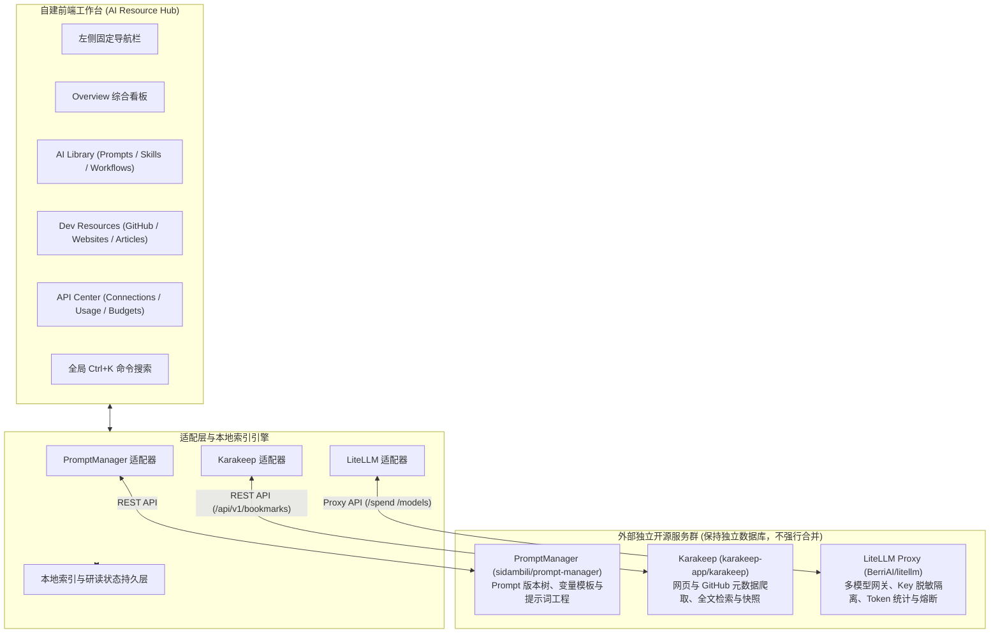

# AI RESOURCE HUB —— 个人 AI 资源与模型管理工作台

> **统一管理个人 AI 资产，深度复用成熟开源项目生态，打造极简高效的个人 AI 生产力中枢。**

---

## 🌟 项目核心定位

在日常开发与 AI 探索过程中，工程师面临提示词分散在各种记事本、GitHub 仓库收藏后吃灰、多个大模型 API 费用混乱超支等痛点。
**AI RESOURCE HUB** 旨在通过**「一个自建聚合工作台 + 三个成熟开源微服务」**的极简架构，实现一站式聚合管理：

1. **统一管理个人 AI 资产**：集中维护 Prompts、Skills 规约与多步骤 Workflows。
2. **深度收藏 GitHub 开源项目与技术站点**：自动解析 Star、语言、License，精细化管理「待研究、研究中、已掌握」研读生命周期。
3. **统一 API 代理与模型连接**：多服务商（OpenAI, Anthropic, DeepSeek, Gemini, Groq）API Key 密文服务端托管与前端脱敏展示。
4. **精确用量与成本核算**：通过统一网关实时捕获 Token 消耗、Input/Output 拆解，严格区分**真实服务商账单**与**理论 Token 估算费用**。
5. **现代高保真仪表盘（Dashboard）**：参考国际顶尖 Fintech / SaaS 设计语言，卡片化 Bento-grid 布局，适量留白，支持深色/浅色主题。

---

## 🏗️ 架构设计与开源生态复用原则

本项目坚持：**优先复用成熟开源项目，坚决杜绝低水平重复开发**。



### 权责边界与服务分工
- **Prompt 管理**：优先参考并复用 [`sidambili/prompt-manager`](https://github.com/sidambili/prompt-manager)，负责多版本比较、参数插槽解析与提示词库管理。
- **资源收藏**：优先复用 [`karakeep-app/karakeep`](https://github.com/karakeep-app/karakeep)（原 Hoarder），负责网页/仓库元数据解析与全文索引；自建 Hub 扩展个人研读状态与独家备忘笔记。
- **模型代理与计费**：优先复用 [`BerriAI/litellm`](https://github.com/BerriAI/litellm)，负责统一负载均衡、真实 API Key 隔离与精确 Token 统计。
- **数据库隔离**：严禁强行将三个项目的数据库揉碎合并。Hub 仅记录轻量级关联关系（例如某一工作流绑定哪条 Prompt + 哪部 Skill + 哪个 GitHub 项目）。

---

## 🎨 视觉与交互规范（对标设计参考图）

- **Bento Grid 容器布局**：卡片统一采用 `rounded-3xl`（24px）大倒角与呼吸感留白。
- **高光焦点卡片（Accent Gradient Card）**：Dashboard 中心采用天蓝至宝蓝渐变卡片（`bg-gradient-to-br from-blue-500 via-blue-600 to-indigo-700`），彰显核心资产聚合力。
- **胶囊型（Pill）交互**：徽章、状态切换器与关键操作按钮均采用 `rounded-full` 胶囊设计。
- **双模即时切换**：
  - **Demo 高保真演示模式**：开箱即用，内置完备的提示词、代码库、Token 趋势与日志数据。
  - **Live 真实服务模式**：支持配置外部实际部署的 Karakeep、LiteLLM 与 PromptManager 端点并自动探活降级。
- **全链路深浅色主题**：支持一键切换日光浅色（`#F4F7FB`）与暗夜深色（`#080C14`）。

---

## 📂 页面与模块划分

```
左侧导航
├── Overview 看板
│   ├── KPI 核心矩阵（Prompts/Skills/Workflows/GitHub/Token/费用）
│   ├── 30天 Token 吞吐与费用趋势（ECharts 面积平滑图）
│   ├── 模型费用占比排行（Donut Chart）
│   ├── 最近添加的资源（Karakeep & PromptManager 流）
│   └── 最近模型调用记录（LiteLLM 实时日志流）
│
├── AI Library
│   ├── Prompts 提示词（分类筛选、多版本对比、变量插槽填入测试、一键复制）
│   ├── Skills 技能规范（Markdown 在线编辑器、导入导出 .md、标签系统）
│   └── Workflows 工作流（将 Prompt + Skill + 模型串联成自动化处理流水线）
│
├── Dev Resources
│   └── GitHub Projects（深度复用 karakeep-app/karakeep 书签引擎，自动解析 Stars/语言/License，待研究/研究中/已掌握状态流转）
│
└── API Center
    ├── API Connections（统一网关，多服务商 Key 脱敏展示、连通性探活、多模型路由）
    ├── Usage Analytics（Input vs Output Token 拆解、真实发票账单 vs 理论估算对比）
    └── Budgets 预算控制（月度消耗进度、警戒阈值与超支防护策略）
```

---

## 🔗 第三阶段亮点：跨模块资产依赖关系图 (Cross-Asset Relational Graph)

在第三阶段中，各模块不再是孤立的信息孤岛，而是通过统一的数据引擎形成双向可穿透的工程化闭环：
- **Prompt 🔗 Workflow**: 每条提示词卡片清晰标注其已被编排至哪些自动化流水线，点击一键跳转至编排视图。
- **Skill 🔗 Workflow**: 每项工程规约（如 Conventional Commits / OWASP 安全规则）即时显示支撑的生产管线。
- **GitHub Repo 🔗 Workflow**: 每个收藏的开源技术仓库展示其作为技术底座支撑的流水线。
- **AI 资产全景报告导出 (Markdown / PDF / 简历分享)**: 支持一键生成高专业度的技术白皮书与 Markdown 资产清单，可直接复制或下载用于面试展现。

---
